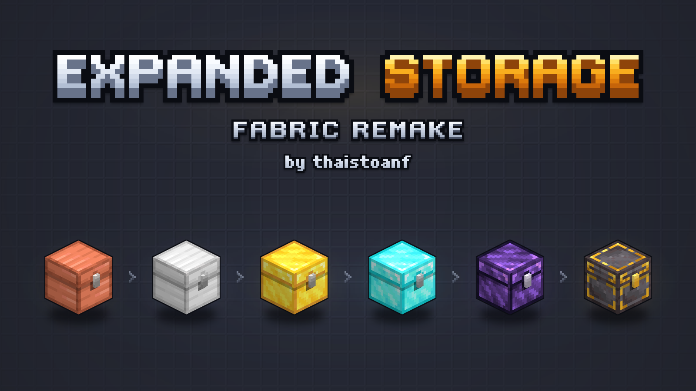

<div align="center">



# Expanded Storage

[](https://github.com/LeThaiToan2k4/Expanded-Storage-REMAKE/blob/Fabric-1.21.4/LICENSE)
[](https://www.minecraft.net/)
[](https://adoptium.net/)
[](https://www.curseforge.com/minecraft/mc-mods/fabric-api)
[](https://www.curseforge.com/members/lethaitoan2k4/projects)
[](https://ko-fi.com/thaistoanf)

**[English Documentation](docs/DOCUMENTATION_EN.md)** | **[Tai Lieu Tieng Viet](docs/DOCUMENTATION_VN.md)** | **[Changelog](CHANGELOG.md)** | **[Credits](CREDITS.md)**

</div>

---

## English

### Overview

**Expanded Storage** is a clean-room remake inspired by the classic *Expanded Storage* mod concept, rewritten from scratch by **thaistoanf** for modern Fabric (`Minecraft 1.21.4`). It focuses strictly on pure Vanilla chest mechanics, high client/server performance, zero external library dependencies (requiring only **Fabric API**), and a flexible dynamic 9-slice GUI system.

### Key Features

- **Six Balanced Chest Tiers:** Copper, Iron, Gold, Diamond, Obsidian, and Netherite chests scaling cleanly from `36` slots up to `270` slots in a double chest.
- **Authentic Vanilla Chest Behavior:** Same-tier side-by-side double chest merging, `Shift`-click isolated placement, lid open/close animations and sounds, cat and solid-block obstruction checks, full Hopper (`Inventory` + `DoubleInventory`) support, and accurate Redstone Comparator output.
- **Seamless T-Shape 9-Slice GUI:** Renders a tightly fitted top chest panel stitched seamlessly onto a centered `176 x 96 px` player inventory panel with no double border and transparent click-through flanks.
- **Three Switchable Layout Modes:** Cycle instantly in-game between **Adaptive Grid**, **Split-Wing** (for double chests), and **Smart Tabbed** (with automatic small-screen fallback).
- **Native Light and Dark GUI:** Built-in 1-click toggle between Vanilla Light and sleek Charcoal Dark themes, persisted automatically to `config/expandedstorage-client.json`.
- **High Performance:** Zero server tick cost, zero idle client tick work when chests are closed, sprite atlas batching inside `minecraft:chest`, and standard Vanilla dirty-slot networking.

### Chest Tiers and Progression

| Tier | Block ID | Single Slots | Double Slots | Blast Resistance | Special Properties | Upgrade Recipe |
| :--- | :--- | :---: | :---: | :---: | :--- | :--- |
| **Copper Chest** | `expandedstorage:copper_chest` | 36 | 72 | 6.0 | Stone Pickaxe+ | 1 Vanilla Chest + 8 Copper Ingots |
| **Iron Chest** | `expandedstorage:iron_chest` | 54 | 108 | 6.0 | Stone Pickaxe+ | 1 Copper Chest + 8 Iron Ingots |
| **Gold Chest** | `expandedstorage:gold_chest` | 81 | 162 | 6.0 | Iron Pickaxe+ | 1 Iron Chest + 8 Gold Ingots |
| **Diamond Chest** | `expandedstorage:diamond_chest` | 108 | 216 | 6.0 | Iron Pickaxe+ | 1 Gold Chest + 2 Diamonds (left/right) + 6 Glass |
| **Obsidian Chest** | `expandedstorage:obsidian_chest` | 108 | 216 | 1200.0 | Explosion-proof, Diamond Pickaxe+ | 1 Diamond Chest + 8 Obsidian |
| **Netherite Chest** | `expandedstorage:netherite_chest` | 135 | 270 | 1200.0 | Explosion-proof, Fireproof/Lava-proof | Smithing: Template + Diamond OR Obsidian Chest + Netherite Ingot |

> **Note:** Breaking a chest drops the chest item and spills its contents normally like Vanilla Minecraft. Upgrades are performed in a Crafting Table or Smithing Table using an empty chest.

### Dynamic GUI System

1. **Adaptive Grid (`ADAPTIVE` - Default):** Displays every chest slot on one screen (`9x4` up to `27x10` for Double Netherite, fitting cleanly inside `1080p` at GUI Scale 3).
2. **Split-Wing (`SPLIT_WING`):** Divides double chests into Left and Right wings (`9x4 | 9x4` through `15x9 | 15x9`) separated by a center groove. Single chests automatically use Adaptive Grid.
3. **Smart Tabbed (`SMART_TABBED`):** Splits large chests into compact top-docked tabs (`10x9` x 3 tabs for Double Netherite; `12x9` x 2 tabs for Double Diamond/Obsidian; `9x9` x 2 tabs for Double Gold; `9x6` x 2 tabs for Double Iron). Players can hold an item on the cursor and click tabs seamlessly without dropping items. Also activates automatically if the game window is too small for Adaptive or Split-Wing.
4. **Light / Dark Theme Toggle:** Switch immediately between `gui_light.png` and `gui_dark.png` via the header button next to the layout toggle.

### Performance and Architecture

- **Zero Idle Tick:** Server chests register no `BlockEntityTicker`. Client chests immediately skip animation math when `viewerCount == 0` and lid progress reaches `0`.
- **Atlas Batching:** All 18 chest entity textures stitch into the Vanilla chest sprite atlas to minimize draw calls in dense storage halls.
- **Multi-Version Isolation:** Version-independent math and tier definitions live in `core/`, while Minecraft API calls are isolated inside `compat/` (`IdCompat`, `StorageCompat`, `NetworkCompat`, `RenderCompat`) for clean porting to newer Fabric versions.

### Building from Source

Requirements: **JDK 21** and Git.

```bash
git clone -b Fabric-1.21.4 https://github.com/LeThaiToan2k4/Expanded-Storage-REMAKE.git
cd Expanded-Storage-REMAKE
./gradlew runDatagen
./gradlew build
```

Output JAR: `build/libs/expandedstorage-rk-fabric-1.21.4-1.0.0.jar`

### Credits and License

- **Author:** `thaistoanf`
- **License:** MIT License ([LICENSE](LICENSE) | [CREDITS.md](CREDITS.md))
- **Concept & Artwork Attribution:** Inspired by the original *Expanded Storage* mod. The **Iron, Gold, Diamond, Obsidian, and Netherite** chest entity textures are adapted from the original MIT-licensed *Expanded Storage* artwork by **Ellemes** and **Ninni** (remapped cleanly to Vanilla `64x64` chest UVs), and the **Copper Chest** textures were created to match their pixel-art style. All mod code and the 9-slice T-shape GUI system are written from scratch for modern Fabric.
- **GitHub Repository:** https://github.com/LeThaiToan2k4/Expanded-Storage-REMAKE
- **CurseForge Profile:** https://www.curseforge.com/members/lethaitoan2k4/projects
- **Support on Ko-fi:** https://ko-fi.com/thaistoanf
- **Full English Guide:** [docs/DOCUMENTATION_EN.md](docs/DOCUMENTATION_EN.md)

---

## Tieng Viet (Vietnamese)

### Gioi Thieu

**Expanded Storage** la phien ban lam lai doc lap (clean-room remake) lay cam hung tu y tuong mod *Expanded Storage* co dien, duoc **thaistoanf** viet lai hoan toan tu dau cho Fabric hien dai (`Minecraft 1.21.4`). Mod tap trung thuoc tinh ruong chuan Vanilla, toi uu hieu nang toi da, khong phu thuoc thu vien ngoai (chi can **Fabric API**), cung he thong giao dien 9-slice linh hoat.

### Tinh Nang Noi Bat

- **6 Cap Do Ruong Can Bang:** Ruong Dong (Copper), Sat (Iron), Vang (Gold), Kim Cuong (Diamond), Hac Dien Thach (Obsidian) va Netherite, mo rong suc chua tu `36` o den toi da `270` o khi ghep ruong doi.
- **Co Che Chuan Vanilla:** Tu dong ghep ruong doi khi dat 2 ruong cung cap canh nhau, giu `Shift` khi dat de tach rieng, hoat anh va am thanh dong/mo nap, kiem tra vat can va meo ngoi tren ruong, tuong thich hoan toan voi Pheu (Hopper) va Mach So Sanh Redstone (Comparator).
- **Khung Giao Dien Chu T Lien Mach:** Ket hop khung ruong phia tren voi khung tui do nguoi choi `176 x 96 px` o giua phia duoi khong bi vien doi, hai vung trong hai ben hoan toan xuyen thau khi click tha vat pham.
- **3 Che Do Bo Cuc Linh Hoat:** Chuyen doi tuc thi giua **Luoi Thich Ung (Adaptive Grid)**, **Chia Hai Canh (Split-Wing)** va **Phan Trang Tab (Smart Tabbed)** (tu dong kich hoat khi cua so game nho).
- **Giao Dien Sang / Toi Tich Hop:** Chuyen nhanh giua giao dien Sang truyen thong va giao dien Toi sac net, tu dong luu vao `config/expandedstorage-client.json`.
- **Hieu Nang Cao:** Khong ton tick tren server khi dong ruong, gom chung texture vao Chest Atlas cua Vanilla va chi dong bo cac o thay doi.

### Bang Cap Do Ruong va Cong Thuc

| Cap Ruong | ID Khoi | Ruong Don | Ruong Doi | Khang No | Thuoc Tinh Dac Biet | Cong Thuc Nang Cap |
| :--- | :--- | :---: | :---: | :---: | :--- | :--- |
| **Ruong Dong** | `expandedstorage:copper_chest` | 36 | 72 | 6.0 | Cup Da tro len | 1 Ruong Go + 8 Thoi Dong |
| **Ruong Sat** | `expandedstorage:iron_chest` | 54 | 108 | 6.0 | Cup Da tro len | 1 Ruong Dong + 8 Thoi Sat |
| **Ruong Vang** | `expandedstorage:gold_chest` | 81 | 162 | 6.0 | Cup Sat tro len | 1 Ruong Sat + 8 Thoi Vang |
| **Ruong Kim Cuong** | `expandedstorage:diamond_chest` | 108 | 216 | 6.0 | Cup Sat tro len | 1 Ruong Vang + 2 Kim Cuong (trai/phai) + 6 Kinh |
| **Ruong Hac Dien Thach** | `expandedstorage:obsidian_chest` | 108 | 216 | 1200.0 | Khang no, Cup Kim Cuong+ | 1 Ruong Kim Cuong + 8 Hac Dien Thach |
| **Ruong Netherite** | `expandedstorage:netherite_chest` | 135 | 270 | 1200.0 | Khang no, Khang lua/dung nham | Ban Ren: Khuon Nang Cap + Ruong Kim Cuong HOAC Hac Dien Thach + Thoi Netherite |

> **Luu y:** Khi pha vo ruong, ruong va vat pham ben trong se roi ra binh thuong nhu Vanilla. Viec nang cap thuc hien tren Ban Che Tao hoac Ban Ren voi ruong trong.

### Huong Dan Build Tu Ma Nguon

Yeu cau: **JDK 21** va Git.

```bash
git clone -b Fabric-1.21.4 https://github.com/LeThaiToan2k4/Expanded-Storage-REMAKE.git
cd Expanded-Storage-REMAKE
./gradlew runDatagen
./gradlew build
```

File JAR dau ra: `build/libs/expandedstorage-rk-fabric-1.21.4-1.0.0.jar`

### Ghi Nhan Ban Quyen va Lien Ket

- **Tac gia:** `thaistoanf`
- **Giay phep:** MIT License ([LICENSE](LICENSE) | [CREDITS.md](CREDITS.md))
- **Ghi nhan y tuong & Texture:** Lay cam hung tu mod *Expanded Storage* co dien. Cac texture ruong **Sat, Vang, Kim Cuong, Hac Dien Thach va Netherite** duoc chuyen doi chuan UV `64x64` tu bo tai nguyen giay phep MIT goc cua **Ellemes** va **Ninni**, dong thoi texture **Ruong Dong** duoc thiet ke dong bo theo cung phong cach pixel-art do. Toan bo ma nguon va he thong giao dien 9-slice chu T duoc viet moi tu dau cho Fabric.
- **Kho ma nguon GitHub:** https://github.com/LeThaiToan2k4/Expanded-Storage-REMAKE
- **Trang CurseForge:** https://www.curseforge.com/members/lethaitoan2k4/projects
- **Ung ho qua Ko-fi:** https://ko-fi.com/thaistoanf
- **Tai lieu chi tiet Tieng Viet:** [docs/DOCUMENTATION_VN.md](docs/DOCUMENTATION_VN.md)
