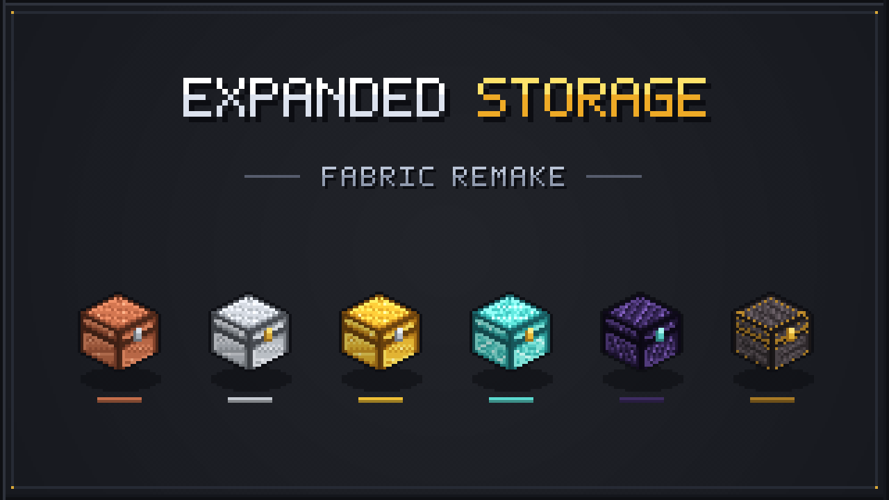

 

---

## Overview

**Expanded Storage** is a clean-room remake inspired by the classic *Expanded Storage* mod, rewritten from scratch by **thaistoanf** for Fabric. It brings six balanced, Vanilla-faithful chest tiers with high FPS/TPS performance, zero third-party config library bloat, and a sleek dynamic 9-slice GUI.

---

## Six Progressive Chest Tiers

Every chest follows authentic Vanilla Minecraft chest behavior: place two chests of the **same tier** side-by-side to form a **Double Chest**, hold **Shift** while placing to keep them separate, automate freely with **Hoppers**, and read fill levels with **Redstone Comparators**.

- **Copper Chest:** `36` Slots (Single) | `72` Slots (Double) - Crafted with 1 Vanilla Chest surrounded by 8 Copper Ingots.
- **Iron Chest:** `54` Slots (Single) | `108` Slots (Double) - Crafted with 1 Copper Chest surrounded by 8 Iron Ingots.
- **Gold Chest:** `81` Slots (Single) | `162` Slots (Double) - Crafted with 1 Iron Chest surrounded by 8 Gold Ingots.
- **Diamond Chest:** `108` Slots (Single) | `216` Slots (Double) - Survival-friendly recipe using 1 Gold Chest in the center, 2 Diamonds on the left and right, and 6 Glass blocks in the remaining outer slots.
- **Obsidian Chest:** `108` Slots (Single) | `216` Slots (Double) - Crafted with 1 Diamond Chest surrounded by 8 Obsidian. Fully blast-resistant against explosions.
- **Netherite Chest:** `135` Slots (Single) | `270` Slots (Double) - Upgraded in a Smithing Table using a Netherite Upgrade Smithing Template + **either** a Diamond Chest **or** an Obsidian Chest + 1 Netherite Ingot. Blast-resistant and fireproof/lava-proof as a dropped item.

*Note: Breaking a chest drops the chest and spills its items normally just like a Vanilla chest. Upgrades are crafted using an empty chest.*

---

## Modern Dynamic GUI (No Laggy Scrollbars)

- **Seamless T-Shape Framing:** Connects a tightly fitted chest grid on top to a centered player inventory below with no awkward double borders. The empty left and right flanks remain completely click-through so dropping held items feels natural.
- **Three Switchable Layout Modes:**
  1. **Adaptive Grid (Default):** Fits all slots cleanly onto a single screen (`9x4` up to `27x10`).
  2. **Split-Wing:** Displays double chests as two distinct Left and Right wings separated by a clean center divider.
  3. **Smart Tabbed:** Organizes large chests into compact top-docked tabs (and activates automatically on small windows or high GUI scales). Hold items on your cursor and switch tabs effortlessly without dropping stacks.
- **Built-In Light and Dark Themes:** Switch instantly between classic Vanilla Light and crisp Charcoal Dark themes using the header toggle button. Preferences save automatically.

---

## Built for Performance

- **Zero Idle Tick Cost:** Closed chests perform zero server tick work and zero idle client animation math, keeping FPS and TPS smooth even in massive storage halls.
- **Sprite Atlas Batching:** All chest textures batch into the Vanilla chest atlas to minimize GPU draw calls.
- **Lightweight Dependencies:** Requires only **Fabric API** - no external configuration or rendering libraries needed.

---

## Credits and Links

- **Author:** `thaistoanf`
- **Inspiration:** Clean remake inspired by the original *Expanded Storage* concept.
- **Source Code & Issues:** [GitHub Repository](https://github.com/LeThaiToan2k4/Expanded-Storage-REMAKE)
- **More Projects:** [CurseForge Profile](https://www.curseforge.com/members/lethaitoan2k4/projects)
- **Support Development:** [Ko-fi (thaistoanf)](https://ko-fi.com/thaistoanf)
