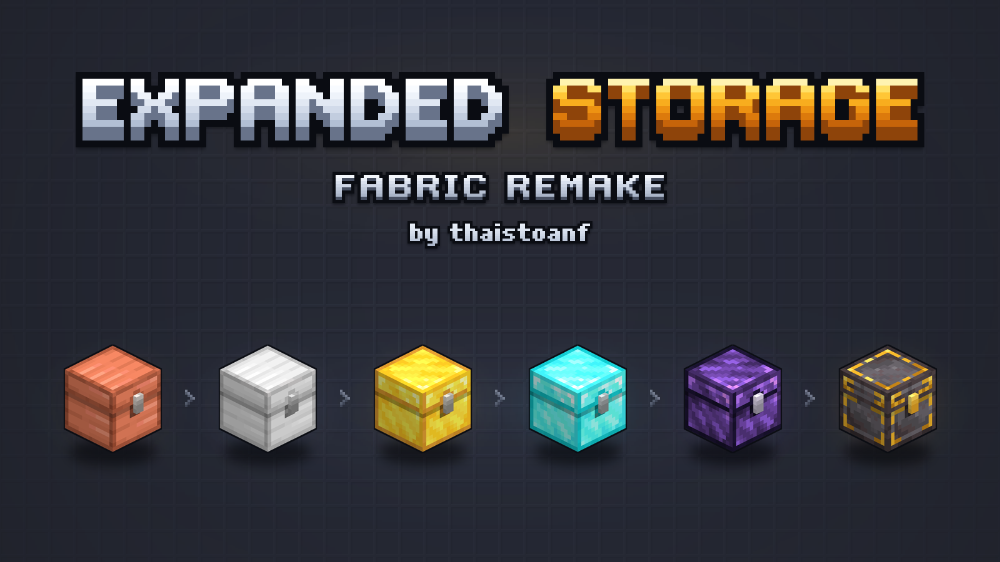
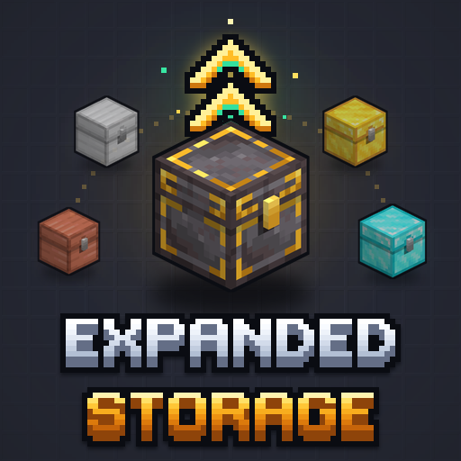

# Expanded Storage - Complete English Documentation





- **Mod Name:** Expanded Storage
- **Mod ID:** `expandedstorage`
- **Author:** `thaistoanf`
- **Minecraft Target:** `1.21.3` (Fabric)
- **Dependencies:** Fabric Loader (`>=0.20.1`), Fabric API (`>=0.114.1+1.21.3`), Java `21`
- **Repository:** https://github.com/LeThaiToan2k4/Expanded-Storage-REMAKE
- **CurseForge:** https://www.curseforge.com/members/lethaitoan2k4/projects
- **Ko-fi:** https://ko-fi.com/thaistoanf

**Expanded Storage** is a clean-room remake inspired by the classic *Expanded Storage* mod, rewritten from scratch for modern Fabric with zero external config or rendering library dependencies. The **Iron, Gold, Diamond, Obsidian, and Netherite** chest textures are adapted from the original MIT-licensed artwork by **Ellemes** and **Ninni**, with **Copper Chest** textures created to match their pixel-art style (see [../CREDITS.md](../CREDITS.md)).

---

## 1. Gameplay Scope and Vanilla Mechanics

Expanded Storage intentionally focuses on **tiered chests only** (no barrels, trapped chests, mini chests, or in-world conversion kits) so every block behaves predictably like a native Minecraft chest:

- **Same-Tier Merging:** Placing two chests of the exact same tier side-by-side forms a Double Chest with double capacity. Different tiers never merge with each other or with Vanilla wooden chests.
- **Sneak Placement:** Holding `Shift` while placing a chest prevents merging with an adjacent chest, matching Vanilla placement rules.
- **Obstruction Checks:** Chests cannot be opened when a full solid block or a sitting cat rests directly on top.
- **Redstone and Automation:** Full support for Hoppers (`Inventory` for single chests and `DoubleInventory` spanning both halves of double chests) and Redstone Comparators.
- **Breaking and Upgrading:** Breaking a chest drops the chest item (preserving custom anvil names) and scatters its stored items. Chests are upgraded at a Crafting Table or Smithing Table while empty.

---

## 2. Chest Tiers and Crafting Recipes

### Tier Summary

| Tier | Identifier | Single | Double | Hardness | Blast Resistance | Tool Requirement | Fireproof Item |
| :--- | :--- | :---: | :---: | :---: | :---: | :--- | :---: |
| Copper | `expandedstorage:copper_chest` | 36 | 72 | 3.0 | 6.0 | Stone Pickaxe+ | No |
| Iron | `expandedstorage:iron_chest` | 54 | 108 | 5.0 | 6.0 | Stone Pickaxe+ | No |
| Gold | `expandedstorage:gold_chest` | 81 | 162 | 3.0 | 6.0 | Iron Pickaxe+ | No |
| Diamond | `expandedstorage:diamond_chest` | 108 | 216 | 5.0 | 6.0 | Iron Pickaxe+ | No |
| Obsidian | `expandedstorage:obsidian_chest` | 108 | 216 | 10.0 | 1200.0 | Diamond Pickaxe+ | No |
| Netherite | `expandedstorage:netherite_chest` | 135 | 270 | 12.0 | 1200.0 | Diamond Pickaxe+ | Yes |

### Exact Recipe Layouts

1. **Copper Chest (`copper_chest`) - Shaped Crafting:**
   - Center: `minecraft:chest`
   - Outer 8 slots: `minecraft:copper_ingot`
2. **Iron Chest (`iron_chest`) - Shaped Crafting:**
   - Center: `expandedstorage:copper_chest`
   - Outer 8 slots: `minecraft:iron_ingot`
3. **Gold Chest (`gold_chest`) - Shaped Crafting:**
   - Center: `expandedstorage:iron_chest`
   - Outer 8 slots: `minecraft:gold_ingot`
4. **Diamond Chest (`diamond_chest`) - Budget Shaped Crafting:**
   - Top row: `Glass | Glass | Glass`
   - Middle row: `Diamond | Gold Chest | Diamond`
   - Bottom row: `Glass | Glass | Glass`
5. **Obsidian Chest (`obsidian_chest`) - Shaped Crafting:**
   - Center: `expandedstorage:diamond_chest`
   - Outer 8 slots: `minecraft:obsidian`
6. **Netherite Chest (`netherite_chest`) - Smithing Table (Two Valid Paths):**
   - **Path A:** `minecraft:netherite_upgrade_smithing_template` + `expandedstorage:diamond_chest` + `minecraft:netherite_ingot`
   - **Path B:** `minecraft:netherite_upgrade_smithing_template` + `expandedstorage:obsidian_chest` + `minecraft:netherite_ingot`

---

## 3. Dynamic 9-Slice GUI System

Expanded Storage replaces laggy scrollbars with a dynamic 9-slice T-shape renderer backed by two compact `128x128` sprite sheets (`gui_light.png` and `gui_dark.png`).

### T-Shape Panel Geometry and Click-Through Flanks

- **Top Chest Panel:** Dynamically sized to wrap the active chest slot grid (`cols x rows`) with a `17px` header bar.
- **Bottom Player Inventory Panel:** Fixed Vanilla `176 x 96 px` (`9x4` player inventory + hotbar) centered underneath the chest panel and stitched seamlessly across the shared horizontal border with inner-corner bevel joints.
- **Click-Through Flanks:** `ExpandedChestScreen.isClickOutsideBounds` tests clicks against the exact union of the chest panel, player panel, active tabs, and header buttons. Clicking the open left or right flanks beside the player inventory drops held cursor items naturally instead of hitting an invisible wall.

### GUI Layout Modes (`cols x rows`)

| Tier | Adaptive (Single) | Adaptive (Double) | Split-Wing (Double) | Smart Tabbed (Single) | Smart Tabbed (Double) |
| :--- | :---: | :---: | :---: | :---: | :---: |
| Copper | `9x4` (36) | `12x6` (72) | `9x4 \| 9x4` | `9x4` x 1 tab | `9x4` x 2 tabs (36/tab) |
| Iron | `9x6` (54) | `12x9` (108) | `9x6 \| 9x6` | `9x6` x 1 tab | `9x6` x 2 tabs (54/tab) |
| Gold | `9x9` (81) | `18x9` (162) | `9x9 \| 9x9` | `9x9` x 1 tab | `9x9` x 2 tabs (81/tab) |
| Diamond | `12x9` (108) | `24x9` (216) | `12x9 \| 12x9` | `9x6` x 2 tabs | `12x9` x 2 tabs (108/tab) |
| Obsidian | `12x9` (108) | `24x9` (216) | `12x9 \| 12x9` | `9x6` x 2 tabs | `12x9` x 2 tabs (108/tab) |
| Netherite | `15x9` (135) | `27x10` (270) | `15x9 \| 15x9` | `9x5` x 3 tabs | `10x9` x 3 tabs (90/tab) |

- **Automatic Fallback:** If the active `ADAPTIVE` or `SPLIT_WING` layout exceeds the current scaled game window width or height, `LayoutCalculator` automatically switches to `SMART_TABBED` (and clamps columns/rows further if needed) so every slot remains accessible on any resolution or GUI scale.
- **Cursor Stack Persistence Across Tabs:** Clicking a tab or header toggle button suppresses click-release outside-bounds item dropping, allowing players to pick up an item stack on Tab 1, click Tab 3, and place the stack directly.

---

## 4. Client Configuration

Client visual preferences are saved automatically to `config/expandedstorage-client.json` using Minecraft's bundled Gson:

```json
{
  "guiMode": "ADAPTIVE",
  "darkGui": false
}
```

- `guiMode`: `"ADAPTIVE"`, `"SPLIT_WING"`, or `"SMART_TABBED"`.
- `darkGui`: `false` for `gui_light.png`, `true` for `gui_dark.png`.

---

## 5. Multi-Version Architecture (`1.20.1` -> `1.21.11+`)

```text
com.thaistoanf.expandedstorage
|-- core/        Pure Java math & enums (ChestTier, GuiMode, LayoutCalculator, ClientConfig)
|-- compat/      Version-specific Minecraft/Fabric adapters (IdCompat, StorageCompat, NetworkCompat, RenderCompat)
|-- block/       ExpandedChestBlock & entity/ExpandedChestBlockEntity
|-- screen/      ExpandedChestScreenHandler & ExpandedChestScreen
|-- registry/    ModBlocks, ModBlockEntities, ModScreenHandlers, ModItemGroups
|-- client/      ExpandedStorageClient & ExpandedChestBlockEntityRenderer
`-- datagen/     ExpandedStorageDataGenerator, ModRecipeProvider, ModLootTableProvider, ModBlockTagProvider
```

Over 95% of layout math, tier metadata, and config persistence stays unchanged across Minecraft versions; Mojang breaking API changes are isolated inside `compat/`.
