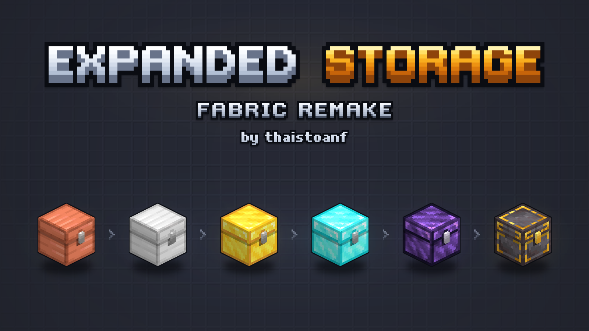
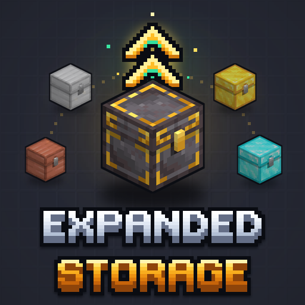

# Expanded Storage - Tai Lieu Chi Tiet (Tieng Viet)





- **Ten Mod:** Expanded Storage
- **Mod ID:** `expandedstorage`
- **Tac gia:** `thaistoanf`
- **Phien ban Minecraft:** `1.20.6` (Fabric)
- **Yeu cau:** Fabric Loader (`>=0.20.1`), Fabric API (`>=0.100.8+1.20.6`), Java `21`
- **Kho ma nguon:** https://github.com/LeThaiToan2k4/Expanded-Storage-REMAKE
- **CurseForge:** https://www.curseforge.com/members/lethaitoan2k4/projects
- **Ko-fi:** https://ko-fi.com/thaistoanf

**Expanded Storage** la phien ban lam lai doc lap (clean-room remake) lay cam hung tu mod *Expanded Storage* co dien, duoc viet lai hoan toan tu dau cho Fabric hien dai ma khong phu thuoc vao bat ky thu vien ben thu ba nao ngoai Fabric API. Cac texture ruong **Sat, Vang, Kim Cuong, Hac Dien Thach va Netherite** duoc ke thua tu tai nguyen giay phep MIT cua **Ellemes** va **Ninni**, ket hop voi texture **Ruong Dong** duoc thiet ke dong bo cung phong cach (xem [../CREDITS.md](../CREDITS.md)).

---

## 1. Pham Vi Gameplay va Co Che Chuan Vanilla

Mod tap trung hoan toan vao **Ruong nang cap theo cap bac** (khong co Thung Barrel, Ruong Bay, Ruong Mini hay Vat pham nang cap truc tiep) nham giu dung trai nghiem muot ma nhat cua Minecraft Vanilla:

- **Ghep Ruong Doi Cung Cap:** Dat hai ruong cung cap canh nhau se tu dong tao thanh Ruong Doi voi gap doi so o chua. Cac ruong khac cap khong bao gio tu ghep voi nhau hoac voi ruong go Vanilla.
- **Giu Shift Khi Dat:** Giu phim `Shift` khi dat ruong de ngan ghep doi, giong het co che Vanilla.
- **Kiem Tra Vat Can:** Ruong bi chan mo khi co khoi dac hoac meo dang ngoi ngay phia tren.
- **Tu Dong Hoa va Redstone:** Ho tro day du Pheu (`Inventory` cho ruong don va `DoubleInventory` cho toan bo ruong doi) cung Mach So Sanh Redstone (Comparator).
- **Pha Vo va Nang Cap:** Pha ruong se lam roi vat pham ruong (giu nguyen ten doi tren De) va roi toan bo do ben trong ra ngoai. Nang cap ruong duoc thuc hien tren Ban Che Tao hoac Ban Ren khi ruong dang trong.

---

## 2. Thong So 6 Cap Ruong va Cong Thuc Che Tao

### Bang Thong So Chi Tiet

| Cap Ruong | Dinh Danh (ID) | Ruong Don | Ruong Doi | Do Cung | Khang No | Cong Cu Khai Thac | Khang Lua / Dung Nham |
| :--- | :--- | :---: | :---: | :---: | :---: | :--- | :---: |
| Ruong Dong | `expandedstorage:copper_chest` | 36 | 72 | 3.0 | 6.0 | Cup Da tro len | Khong |
| Ruong Sat | `expandedstorage:iron_chest` | 54 | 108 | 5.0 | 6.0 | Cup Da tro len | Khong |
| Ruong Vang | `expandedstorage:gold_chest` | 81 | 162 | 3.0 | 6.0 | Cup Sat tro len | Khong |
| Ruong Kim Cuong | `expandedstorage:diamond_chest` | 108 | 216 | 5.0 | 6.0 | Cup Sat tro len | Khong |
| Ruong Hac Dien Thach | `expandedstorage:obsidian_chest` | 108 | 216 | 10.0 | 1200.0 | Cup Kim Cuong tro len | Khong |
| Ruong Netherite | `expandedstorage:netherite_chest` | 135 | 270 | 12.0 | 1200.0 | Cup Kim Cuong tro len | Co |

### Chi Tiet Cong Thuc Che Tao

1. **Ruong Dong (`copper_chest`) - Ban Che Tao 3x3:**
   - O giua: `minecraft:chest` (Ruong go Vanilla)
   - 8 o xung quanh: `minecraft:copper_ingot` (Thoi Dong)
2. **Ruong Sat (`iron_chest`) - Ban Che Tao 3x3:**
   - O giua: `expandedstorage:copper_chest`
   - 8 o xung quanh: `minecraft:iron_ingot` (Thoi Sat)
3. **Ruong Vang (`gold_chest`) - Ban Che Tao 3x3:**
   - O giua: `expandedstorage:iron_chest`
   - 8 o xung quanh: `minecraft:gold_ingot` (Thoi Vang)
4. **Ruong Kim Cuong (`diamond_chest`) - Cong Thuc Tiet Kiem 3x3:**
   - Hang tren: `Kinh | Kinh | Kinh`
   - Hang giua: `Kim Cuong | Ruong Vang | Kim Cuong`
   - Hang duoi: `Kinh | Kinh | Kinh`
5. **Ruong Hac Dien Thach (`obsidian_chest`) - Ban Che Tao 3x3:**
   - O giua: `expandedstorage:diamond_chest`
   - 8 o xung quanh: `minecraft:obsidian` (Hac Dien Thach)
6. **Ruong Netherite (`netherite_chest`) - Ban Ren (Ho Tro Ca 2 Nhanh Nang Cap):**
   - **Nhanh A:** `Khuon Nang Cap Netherite` + `Ruong Kim Cuong` + `Thoi Netherite`
   - **Nhanh B:** `Khuon Nang Cap Netherite` + `Ruong Hac Dien Thach` + `Thoi Netherite`

---

## 3. He Thong Giao Dien 9-Slice Hien Dai

Expanded Storage loai bo thanh cuon va nut mui ten cu ky, thay bang he thong cat ghep 9-slice dong tu hai tep sprite nho gon `128x128` (`gui_light.png` va `gui_dark.png`).

### Khung Vien Chu T va Vung Trong Xuyen Thau

- **Khung Ruong Phia Tren:** Tu dong co gian vua khit luoi o chua cua cap ruong hien tai.
- **Khung Tui Do Nguoi Choi Phia Duoi:** Co dinh kich thuoc chuan Vanilla `176 x 96 px` (`9x4`), dat can giua va noi lien mach voi day khung ruong phia tren ma khong tao vien doi.
- **Hai Canh Ben Xuyen Thau:** Ham `isClickOutsideBounds` kiem tra chinh xac hop cua hai hinh chu nhat tao thanh chu T. Nguoi choi click vao vung trong ben trai hoac ben phai khung tui do se tha vat pham tren con tro ra ngoai tu nhien.

### Kich Thuoc Luoi Theo 3 Che Do (`cot x hang`)

| Cap Ruong | Adaptive (Don) | Adaptive (Doi) | Split-Wing (Doi) | Smart Tabbed (Don) | Smart Tabbed (Doi) |
| :--- | :---: | :---: | :---: | :---: | :---: |
| Dong | `9x4` (36) | `12x6` (72) | `9x4 \| 9x4` | `9x4` x 1 tab | `9x4` x 2 tab (36 o/tab) |
| Sat | `9x6` (54) | `12x9` (108) | `9x6 \| 9x6` | `9x6` x 1 tab | `9x6` x 2 tab (54 o/tab) |
| Vang | `9x9` (81) | `18x9` (162) | `9x9 \| 9x9` | `9x9` x 1 tab | `9x9` x 2 tab (81 o/tab) |
| Kim Cuong | `12x9` (108) | `24x9` (216) | `12x9 \| 12x9` | `9x6` x 2 tab | `12x9` x 2 tab (108 o/tab) |
| Hac Dien Thach | `12x9` (108) | `24x9` (216) | `12x9 \| 12x9` | `9x6` x 2 tab | `12x9` x 2 tab (108 o/tab) |
| Netherite | `15x9` (135) | `27x10` (270) | `15x9 \| 15x9` | `9x5` x 3 tab | `10x9` x 3 tab (90 o/tab) |

- **Tu Dong Thu Gon Khi Man Hinh Nho:** Neu cua so game hoac GUI Scale hien tai nho hon kich thuoc cua che do `ADAPTIVE` hoac `SPLIT_WING`, `LayoutCalculator` tu dong chuyen sang `SMART_TABBED` de dam bao khong bao gio bi tran khoi man hinh.
- **Giu Vat Pham Tren Con Tro Khi Chuyen Tab:** Nguoi choi co the cam vat pham tren con tro chuot va nhan chuyen qua lai giua cac Tab hoac doi giao dien Sang/Toi ma khong bi roi vat pham.

---

## 4. Tep Cau Hinh Client

Tuy chon giao dien duoc luu tu dong tai `config/expandedstorage-client.json` bang thu vien Gson co san cua Minecraft:

```json
{
  "guiMode": "ADAPTIVE",
  "darkGui": false
}
```

- `guiMode`: `"ADAPTIVE"`, `"SPLIT_WING"`, hoac `"SMART_TABBED"`.
- `darkGui`: `false` (Giao dien Sang) hoac `true` (Giao dien Toi).

---

## 5. Kien Truc Da Phien Ban (`1.20.1` -> `1.21.11+`)

```text
com.thaistoanf.expandedstorage
|-- core/        Logic toan hoc & cau hinh doc lap phien ban (ChestTier, GuiMode, LayoutCalculator, ClientConfig)
|-- compat/      Lop chuyen doi API Minecraft/Fabric (IdCompat, StorageCompat, NetworkCompat, RenderCompat)
|-- block/       ExpandedChestBlock & entity/ExpandedChestBlockEntity
|-- screen/      ExpandedChestScreenHandler & ExpandedChestScreen
|-- registry/    ModBlocks, ModBlockEntities, ModScreenHandlers, ModItemGroups
|-- client/      ExpandedStorageClient & ExpandedChestBlockEntityRenderer
`-- datagen/     ExpandedStorageDataGenerator, ModRecipeProvider, ModLootTableProvider, ModBlockTagProvider
```

Hon 95% ma nguon tinh toan bo cuc va du lieu cap ruong nam trong `core/` khong can chinh sua khi nang cap len cac phien ban Minecraft moi; moi thay doi API cua Mojang deu duoc co lap gon gang trong goi `compat/`.
